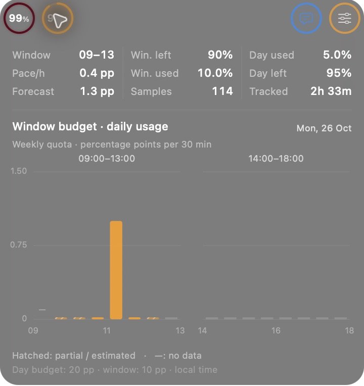
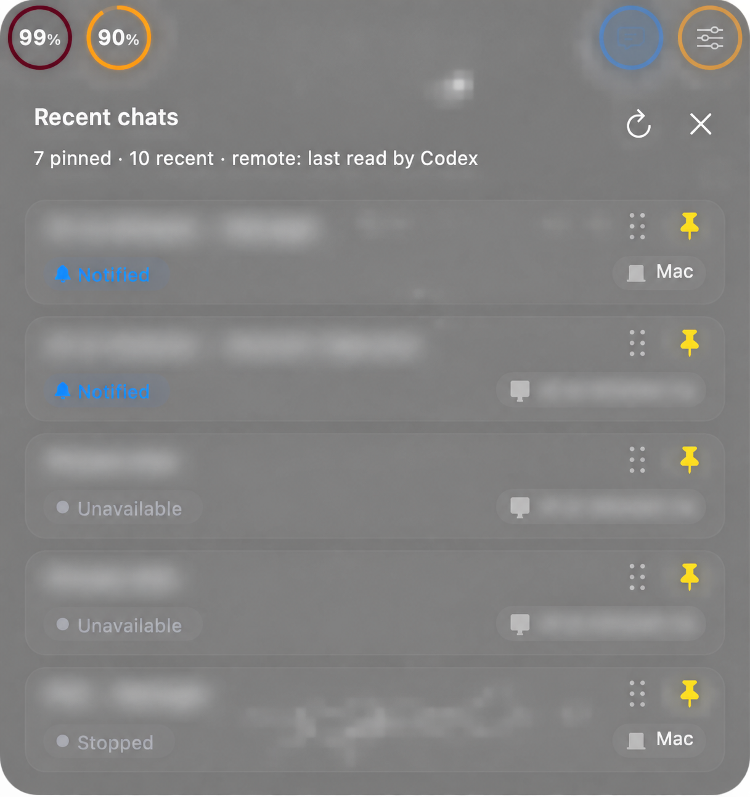

# notchGPT

A native macOS notch extension for shared ChatGPT Work / Codex allowance, a local
working-day budget, and a compact usage chart. White labels, dark native glass,
no Dock icon while running. The app bundle has an original blue/teal allowance icon
in an activity-tracker style, reproducible with `swift scripts/generate-icon.swift`. Click to expand or collapse; click outside or press Escape to close. All text uses shared native system font styles; numerical readouts use tabular digits. The two percentage dials stay
fixed beside the notch throughout both animations.

## Screenshots — 2.1.0

[View the screenshot gallery](docs/screenshots/README.md). Chat titles and remote computer names are blurred for privacy; account and Settings previews use synthetic values.

| Daily usage | Recent chats — private details blurred |
| --- | --- |
|  |  |

## What it shows

- **Left dial** (dark yellow by default): the smallest remainder of the quota windows returned for Codex.
  For 80% left in one window and 25% in another, it displays 25%. Fractional
  remainders round down. This is the shared ChatGPT Work/Codex subscription meter;
  it is not classic ChatGPT message limits, voice/image quota or API billing.
- **Second dial** (dark purple by default): the remaining local budget for the selected **09–13 or 14–18,
  Monday–Friday** block. Each block has **10 percentage points of the full weekly
  quota**, equivalent to half of the twenty-point workday budget. Three weekly
  points spent in that block leave 70% of its window budget.
- Click the left dial for dedicated account statistics: each official quota window,
  used/remaining percentages and reset date. Click the second dial for local
  window target consumption, selected four-hour block,
  observed pace, forecast at the end of that block and sample count, plus a third
  column for daily budget used, daily budget left and tracked time. A daily bar
  chart shows sixteen 30-minute increments: eight for 09:00–13:00 and eight for
  14:00–18:00. Hover over a bar for its interval and value.
- The compact card matches the physical notch height exactly. Its closed left and right
  extensions have equal widths based on the original smaller right extension:
  **76 pt per side at every text size**. The two right-hand buttons each occupy
  38 pt, with larger outline icons balanced against the two readouts. The independently colored
  rings sit side by side, with the remaining percentage inside each
  circle. They animate changes for 0.35 s;
  unavailable readings show muted empty tracks and `—%`. There is no idle animation,
  and Reduce Motion is respected. Dropdown body insets are 12 pt.
- An unavailable value is `—%`; window is also unavailable on weekends or without
  a weekly (10,080-minute) window.
- A right-click menu exposes refresh, update time, partial-coverage notices
  and quit. Login startup is available through the installer.

Allowance refreshes at startup, on wake and manually. The default interval is **60 seconds**. The header contains two independent allowance dials on the left, the physical notch, the recent-chat button and the settings gear on the right.

Both statistics views, recent chats and Settings share **one panel, one continuous glass background and the same expanded height**, matching the chat dropdown material. A common compact 344 pt body (382 pt total with a 38 pt notch header) is capped to the available screen height. The ten-chat list scrolls inside that viewport; Settings uses compact row spacing and the daily chart fits the same surface. Choosing five chats preserves that common height. Their horizontal bounds run from the allowance readout’s left edge to the gear button’s right edge. Click a header control to open or close its dropdown; click outside or press Escape to close. All transitions use the same 0.24-second easing, with anchored header controls and unscaled text.

The chat list shows the ten most recently updated chats by default, including pinned chats. It displays `running` (animated green indicator), `waiting for input` (input or approval), `notified` (blue bell for unread activity), or `stopped`, plus a Mac/Cloud badge or the **remote computer’s name**. Rows use rounded cards, white titles, colored status pills, host badges and hover feedback. Five cards fit the compact viewport, with ten accessible by scrolling. The two right-hand controls use matching 32 pt circles using the selected dial colors with centered symbols and selected/hover feedback, aligned with the allowance dials. The pin button on each row fixes that chat to the top of this dropdown; pin order survives restarts and remains separate from Codex sidebar pins. Drag the dotted handle beside a pinned chat’s pin to change its order. A floating card and insertion line show the destination; the list scrolls near its edges. Release to save, press Escape or release outside the list to cancel. Background refreshes wait until the gesture ends. Up to ten pins retain their host identity. Local pinned chats are looked up even when they fall outside the most recent fifty; an unavailable pinned source keeps an openable placeholder. Pin/unpin does not open the chat. **Each row is a link:** local and remote threads open in Codex with their host identity; cloud tasks open their task page. Chat data refreshes at startup, on opening and every **15 seconds while open** by default. When closed, attention checks run every **30 seconds** (60 seconds if that refresh interval is selected). The chat icon blinks orange for input requests, faster blue for notified activity, and alternates orange/blue when both exist among fetched chats. Failed refreshes preserve the previous attention state. Reduce Motion uses a steady indicator, split orange/blue for combined alerts. Remote states are the last values saved by Codex, not a live host subscription. Computer names come from the read-only Codex computer catalog using the existing ChatGPT sign-in; names refresh at most every five minutes while the list is used, with cached names retained offline. Host identity in the chat link is preserved independently of its display name.

Unread activity uses Codex’s identity-scoped `electron-thread-read-state-v1` and cached per-thread read metadata. Running/input states take precedence over unread activity. The app reads this state without clearing it; opening the chat lets Codex mark it read. Ambiguous retired host keys are not merged.

## Settings

The gear button opens persistent preferences. Changes apply immediately and are saved to `~/Library/Application Support/notchGPT/preferences.json`.

| Preference | Default | Choices / behavior |
| --- | --- | --- |
| ChatGPT color | Dark yellow `#B58A1B` | Native color picker; also colors the recent-chat outline |
| Window color | Dark purple `#7040A0` | Native color picker; also colors the chart and settings outline |
| Open on hover | **Off** | Opt in to opening any header control after a 0.3-second dwell. Click outside or Escape still closes it. Clicking to close is respected until the pointer leaves the control. |
| Dropdown animation | On | Enable or disable the opening/closing animation. Running-chat indicators remain animated. |
| Usage refresh | 60 seconds | 30, 60, 120 or 300 seconds |
| Chat refresh | 15 seconds | 5, 15, 30 or 60 seconds; while open; at least 30 seconds between checks when closed |
| Recent chats | 10 | 5 or 10; all expanded views retain their common height |
| Text size | Normal | Compact, Normal or Large; both extensions stay 76 pt wide |
| Start at login | On | Enables/disables this app’s LaunchAgent for future starts without quitting the current session |

Restore Defaults resets these preferences, including hover **off**. Reinstalling preserves saved preferences and the login choice. The default click-only mode has no hover polling timer.

## Window: a four-hour budget

The second percentage dial uses `100 / (5 × 2) = 10` weekly percentage points per
four-hour block. Its remainder is:

```text
windowRemaining = floor(100 * min(max(0, 10 - observedBlockUse), max(0, 100 - weeklyUsed)) / 10)
```

It is a local planning target, not an official four-hour subscription limit.
The afternoon has its own ten-point allocation; unused morning points do not
carry over. During lunch/after 18:00, today's last observed block stays visible.
Before 09:00, on weekends or without a baseline for an active block, it shows
`—%`. A late start counts only observed consumption. The left dial still displays
the actual shared account quota. Polling and stored chart history are unchanged.

## Daily ledger: two windows, one allowance

The compact card displays the window budget. The expanded third statistics
column displays the percentage of the twenty-point daily budget used and left,
plus tracked time. All application controls, labels, menus and errors use English;
chat titles retain their original language.

The morning and afternoon share **eight working hours and a single twenty-point
budget**. Lunch, evenings and weekends are excluded. No reset occurs at 14:00.
There is no carry-over to the next day. The app allocates allowance rather than
counting down elapsed work time.

```text
working-day budget = 100 weekly percentage points / 5 days = 20
availableToday = min(max(0, 20 - observedWorkSpending), max(0, 100 - weeklyUsed))
dailyRemaining = floor(100 * availableToday / 20)
```

Example: **3 weekly percentage points spent during work consume 15% of today's
budget, leaving 85%** if the weekly balance allows it. The app does not enforce the
target or stop usage at zero. Recorded daily consumption can exceed 100% of the target.

Polling intervals that cross a work boundary are apportioned by the proportion of
working seconds. Intervals over 180 seconds that mix work and non-work are excluded and marked
partial; an interval entirely inside work credits its full observed delta. Starting midway through a day establishes a new baseline, not an invented
history. Retained valid chart samples can restore a conservative minimum after a
ledger migration: the larger observed total is used, never their sum. Coverage
stays partial. Upstream rounding and reporting delays limit accuracy. Daily is a local
estimate, not an additional OpenAI quota.

The **daily bar chart** always uses the current local day, including both work
windows after 18:00. Each bar shows the increment in **weekly percentage points**
for one half-hour, not a cumulative total. Increments between readings are split
proportionally at half-hour boundaries. A small baseline bar means observed zero;
`—` means no data; future slots remain empty. Hatching marks incomplete intervals
or estimated placement across reading gaps longer than 180 seconds. Hovering a
bar provides its exact time range, value and coverage status. Newly recorded
history retains incoming interval boundaries so excluded gaps stay missing;
older history still loads, with long intervals explicitly marked as estimated.

**[Read the full daily calculation guide](docs/daily-budget.md)** for exact formulas,
window boundaries, high-water handling, resets, storage migration, worked examples,
and the different units used by the chart and forecast.

## Requirements

- A notched MacBook, macOS 13 or later. Without a notched display the widget hides.
- An existing ChatGPT-authenticated Codex CLI (bundled with the ChatGPT/Codex
  desktop app or installed separately) that returns numeric account rate limits.
- Network access for quota refresh and Xcode Command Line Tools for building.

No API key, Screen Recording or Accessibility permission is needed by this app.
The Apple Silicon build and repeated animation checks were exercised on a notched
Mac. Intel is compile-checked in the universal build; Intel MacBooks have no notch.

## Build, test and install

```sh
git clone https://github.com/pum-l/notchGPT.git
cd notchGPT
bash scripts/test.sh
bash scripts/build.sh
open build/notchGPT.app
```

For both architectures, use `bash scripts/build.sh --universal`.
Quit any manually opened copy, then install/start at login with:

```sh
bash scripts/install.sh
```

The installer migrates the legacy Notch Usage daily/history ledger locally and removes that old installation when its bundle ID matches. It never migrates Codex credentials.

The installer stages the bundle, installs `~/Applications/notchGPT.app` and a
user LaunchAgent, and starts it without sudo. To update, rebuild and reinstall.
Quit from the widget menu for this session. To uninstall:

```sh
bash scripts/uninstall.sh
```

Builds are ad-hoc signed, not Developer ID signed or notarized. The signature checks
bundle integrity, not publisher identity. Build from reviewed source or use the
normal macOS Privacy & Security / Open Anyway flow for a reviewed downloaded build.

## How it reads allowance

One local `codex app-server` child uses the stdio initialize/initialized handshake
and the `account/rateLimits/read` method. The app selects the `codex` entry from
`rateLimitsByLimitId`, with the legacy `rateLimits` fallback. It never starts a
model turn or sends a prompt. Requests time out after twenty seconds and do not
overlap. Failure clears current numbers and reconnects on the next refresh.
The upstream service can round or delay readings; this is not a live stream.

The CLI is located in system/user Applications or standard Homebrew paths.
A custom executable can be set for a launch:

```sh
CODEX_BIN=/path/to/codex build/notchGPT.app/Contents/MacOS/notchGPT
```

For login startup, add `EnvironmentVariables.CODEX_BIN` to the generated LaunchAgent
and reload it. Reinstalling regenerates that plist. Sign-in problems are resolved
in Codex itself; notchGPT has no credential entry screen.

## Privacy and local files

No built-in analytics or app-specific remote server. The recent-chat feature reads
local title/turn metadata through read-only SQLite connections, saved remote-thread
summaries, existing writer locks (without writing them), and the existing CLI’s
`cloud list --json`. It does not read chat message bodies or tool arguments/outputs.
Titles, status and recency remain in memory and are not written to the usage ledger.

To name remote computers, the helper reads the existing file-backed Codex ChatGPT
session from `CODEX_HOME/auth.json` and sends a **GET** to the same first-party
computer catalog used by the installed Codex app. It never modifies that sign-in,
requests new permissions, follows authenticated redirects, or saves/logs tokens.
Only computer IDs/names, fetch times and a hash of the account ID are cached locally,
with owner-only file permissions. Successful name reads are cached for five minutes;
failures retain that account’s last names and retry after a minute. Unknown machines
have a distinguishable ID fallback rather than a guessed project/computer name.
The catalog route and local metadata formats are internal and can change with
Codex updates. Background polling never resumes a chat, sends a prompt or approves
a request. Clicking a card explicitly opens the selected thread/task. The existing
Codex child uses its normal authentication/networking and can write its diagnostics.

| Local file | Purpose |
| --- | --- |
| `~/Library/Application Support/notchGPT/status.json` | Generic status, percentages, timestamps and widget geometry |
| `~/Library/Application Support/notchGPT/daily-budget.json` | Work spending, previous quota high-water/reset, timestamp, calculation version and coverage |
| `~/Library/Application Support/notchGPT/four-hour-history.json` | Up to fourteen blocks of timestamped cumulative quota samples |
| `~/Library/Application Support/notchGPT/preferences.json` | Saved UI, refresh and login preferences plus host-aware pinned chat IDs |
| `~/Library/Application Support/notchGPT/remote-hosts.json` | Computer names, hashed account binding and cache times; no tokens or chat titles |
| `~/Library/LaunchAgents/dev.notchgpt.mac.plist` | Startup configuration |
| `~/Library/Logs/notchGPT.log` | App stdout/stderr destination |

These generated files are not distributed. Never post authentication files or raw
account responses to public issues. The repository contains code, docs and
synthetic test/preview data only. See [SECURITY.md](SECURITY.md).

## Verification and troubleshooting

`bash scripts/test.sh` runs **84 checks: 13 quota, 29 daily, 35 history/forecast/window and
7 integration checks**, plus preference persistence/validation, optional-hover and recent-chat status/origin/sorting checks,
shell syntax checks and manifest validation. `bash scripts/package.sh` builds a
universal ZIP and SHA-256 file in `dist/`; CI runs math tests and the universal build.

On a notched Mac, the UI regression mode uses synthetic chats and an in-memory preference store. It verifies both dial statistics views, chats and Settings, their shared surface and full width, anchored header controls, click behavior, default hover-off, opt-in dwell behavior, text scaling, list length and row activation. It does not change personal preferences or send a prompt.

```sh
build/notchGPT.app/Contents/MacOS/notchGPT --test-ui
build/notchGPT.app/Contents/MacOS/notchGPT --test-live-chats
```

The second check uses actual read-only metadata to verify ten available chats and their link identities. Preview modes use synthetic values:

```sh
build/notchGPT.app/Contents/MacOS/notchGPT --preview /tmp/notch-compact.png
build/notchGPT.app/Contents/MacOS/notchGPT --preview-expanded /tmp/notch-expanded.png
build/notchGPT.app/Contents/MacOS/notchGPT --preview-chats /tmp/notch-chats.png
build/notchGPT.app/Contents/MacOS/notchGPT --preview-settings /tmp/notch-settings.png
```

- **No widget:** a notched display must be connected and reported by macOS.
- **`—%`:** check the menu error, Codex sign-in and connectivity, then Refresh Now.
- **Window initially 100%:** expected when a block's first baseline is established;
  the menu reports the first observed sample time. Earlier spending is unknown.
- **Rows disagree:** `chatGPT` uses the most restrictive account window; `window`
  uses the weekly quota and a ten-point four-hour target.
- **`window used` and window remaining do not sum to 100:** the weekly balance may
  cap availability, or spending may exceed the window target.
- **Lag:** reads occur once a minute and upstream reporting can also lag.
- **Startup:** inspect `launchctl print "gui/$(id -u)/dev.notchgpt.mac"` and
  the generic local status file; avoid publishing raw personal diagnostics.

See [CONTRIBUTING.md](CONTRIBUTING.md) and [CHANGELOG.md](CHANGELOG.md).

## License

[MIT](LICENSE). Independent community project, unaffiliated with OpenAI or Apple.

## Reproduce the mathematical audit

Freeze copies of `four-hour-history.json` and `daily-budget.json` before analysis. `bash scripts/test.sh` runs the model regressions and an independent second-by-second oracle across 512 intervals, including DST, lunch, weekends, short boundaries, resets and long gaps. To compare a frozen real history with a separate Decimal overlap implementation:

```bash
build/MathAudit /absolute/path/four-hour-history.json build/audit/model-report.json
python3 scripts/audit-math.py /absolute/path/four-hour-history.json build/audit/model-report.json build/audit/verified-report.json
```

The report distinguishes observed percentage points, the local twenty-point daily denominator and estimated long-interval coverage. Old cumulative files cannot reconstruct every original quota poll or retroactively undo reset-timestamp corrections; the audit preserves those files and reports that limit rather than rewriting historical totals.
