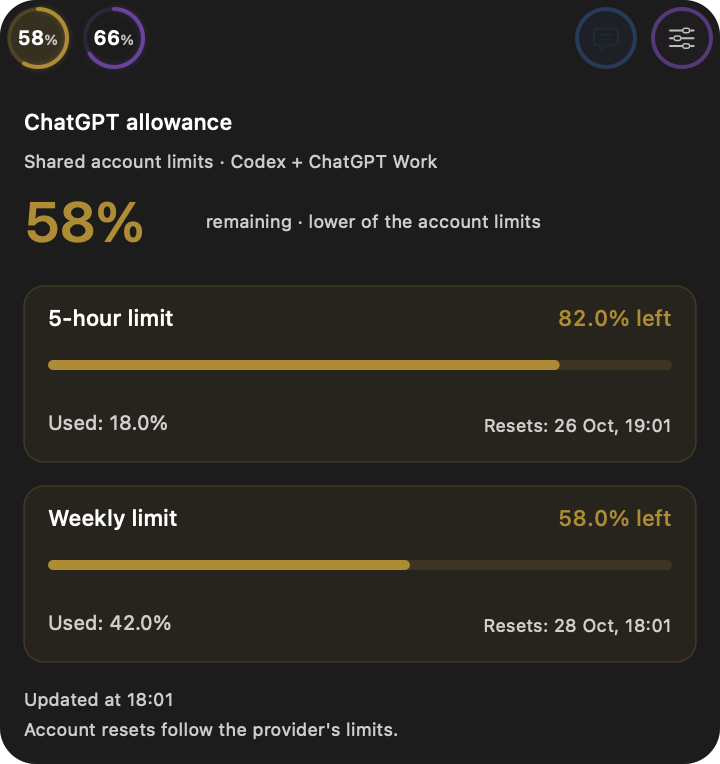
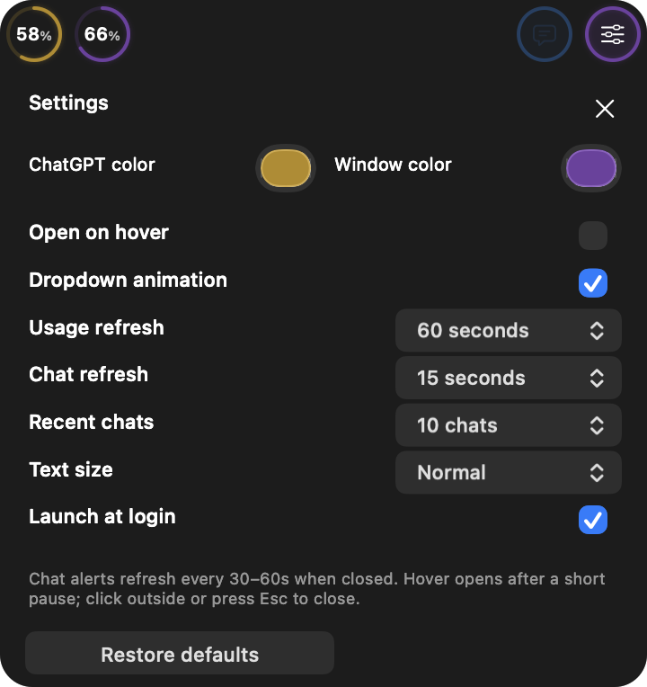

# notchGPT 2.1.0 screenshots

Captured from the macOS app. Chat titles and remote computer names have been strongly blurred for privacy using an image edit; the chat image is a privacy-edited screenshot. Account and Settings views are native app previews with synthetic values and default colors. Other images show the installed app with custom colors. Image metadata has been stripped before publication.

## Compact controls

## Account statistics

## Daily usage

## Recent chats

## Settings

